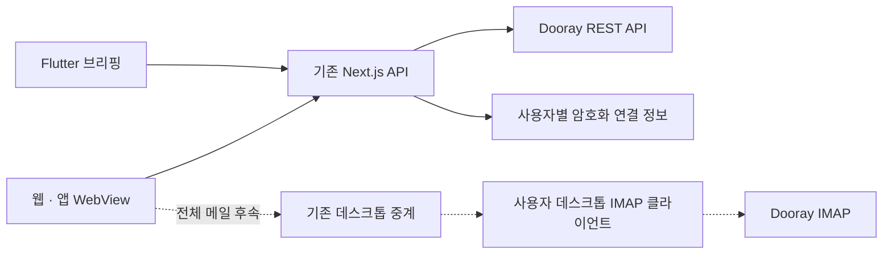

# Dooray 메일·일정·채팅 연동 — 검토 및 재설계

검토일: 2026-10-11 KST. 코드 기준: `origin/main`의 `7b9592d`를 fast-forward 동기화한 작업 트리.
상태: 설계 및 1차 조회 구현. 아래 구현 현황과 미완료 범위를 구분한다.

### 2026-10-11 구현 현황

- 구현: 개인 계정 연결/해제 API·설정 카드, `/dooray` 조회 화면, 일정·최근 메일 피드·참여 대화방 조회, 앱 브리핑 표, 웹/앱 메뉴·권한 키, 매뉴얼, DB 마이그레이션 파일.
- 서버 조회는 `/api/dooray/overview?date=YYYY-MM-DD`로 묶었다. 앱 브리핑은 `briefing=1`을 추가해 대화방을 요청하지 않는다. 이벤트·메일·대화방 실패는 개별 응답으로 격리한다.
- 미구현: 일정 상세/쓰기·IMAP/SMTP·대화 이력. 기존 알림/명부 토큰을 개인 연결로 자동 이관하지 않았다.
- 미적용: 운영 DB 마이그레이션·환경변수·배포. 실계정 API 검증 전이다. 활성화 전 아래 회사 설정이 필요하다.

### 활성화 준비

실계정 1차 검증(2026-10-11): 사용자가 로그인한 `https://nhnent.dooray.com`에서 검증용 토큰으로 공식 API를 호출했다. 본인 확인·캘린더 목록·당일 일정·활동 피드·대화방 목록 모두 HTTP 200 및 `header.isSuccessful=true`를 확인했다. 캘린더 6개, 당일 일정 1건, 첫 활동 페이지 19건 중 메일 9건, 대화방 847개였다. 제목·본문은 검증 기록에 보관하지 않았으며, 임시 토큰은 검증 후 폐기했다. 로컬 실행 환경의 성공이며 배포 서버 IP 환경 검증은 별도다.

확인된 기본 조직 ID는 `3407365765389747827`. 사용자 확인에 따라 Dooray와 이노크루는 독립 계정으로 취급한다. 이메일 일치나 관리자 개별 매핑 없이, 로그인한 이노크루 사용자에게 입력한 토큰의 Dooray 계정을 연결한다. 회사 조직 검증은 유지한다. 아직 운영 연결은 등록하지 않았다. 대규모 대화방 목록은 이름 검색과 50개 단위 표시를 추가했다.

1. 회사의 실제 Dooray 사이트·민간 클라우드 사용 여부·API/IP 정책을 확인한다. 현재 구현의 API 호스트는 `https://api.dooray.com`으로 고정돼 있다.
2. 관리자가 검증한 회사 기본 조직 ID와 사이트를 각각 `DOORAY_ORGANIZATION_ID`, `DOORAY_SITE`(예시 형식 `https://회사테넌트.dooray.com`)에 설정한다. 조직 ID는 공식 `/common/v1/members/me`의 `defaultOrganization.id`로 확인한다. 다른 조직 ID가 나오면 임의로 허용하지 않는다.
3. 별도 32바이트 암호화 키를 `DOORAY_TOKEN_ENC_KEY`(64자리 hex)에 설정한다. 키 원문은 저장소/채팅에 남기지 않는다. 키 교체 시 재연결이 필요하다.
4. `docs/sql/2026-10-11-dooray-connections.sql`을 적용하고, 기존 계정/권한 동작과 일반 사용자 역할에서 토큰 테이블 접근이 차단되는지 확인한다. 계정 삭제 시 연결 행은 FK cascade로 삭제된다.
5. 배포 후 개인 설정에서 토큰을 입력한다. 먼저 두 테스트 사용자로 계정 격리·해제·빈 목록·부분 오류·회사 네트워크 정책을 검증한다. 토큰은 채팅/이슈에 보내지 않는다.

필수 환경변수가 빠져 있으면 설정 카드는 준비 중으로 표시하고 외부 API를 호출하지 않는다. 기존 Teams·아마란스 기능의 설정은 바꾸지 않는다.

## 1. 결론

Dooray를 기존 아마란스·Teams를 대체하는 전역 provider로 만들지 않고, **사용자가 연결해서 쓰는 별도 업무 소스**로 추가한다. 기존 알림 provider 선택은 그대로 유지한다.

- **일정:** 공식 REST API로 목록·상세·단건 등록/수정/삭제를 구현할 수 있다. 먼저 조회와 브리핑을 구현한다.
- **메일:** REST 활동 피드로 최근 메일 소식을 표시할 수 있다. 전체 받은편지함·읽음 상태·검색을 대신하지는 못한다. 완전한 메일 기능에는 별도 IMAP 검증이 필요하다.
- **채팅:** 공식 문서에서 내 대화방 목록과 메시지 전송/수정/삭제는 확인했다. 과거 메시지 목록 조회는 확인하지 못했다. 따라서 Teams 같은 완전한 채팅 화면을 지금 약속하지 않는다.
- **인증:** 공개 서비스 API의 개인 토큰 방식이 확인됐다. Microsoft/Jira 같은 OAuth 연결은 지원 여부가 확인되지 않아 설계 전제로 삼지 않는다. 회사 SSO 로그인과 API 위임 인증은 별개다.

1차 제품은 **연결 설정 + 일정 조회 + 최근 메일 소식 + 대화방 선택/메시지 전송 + 원문 열기**다. 전체 메일과 대화 이력은 아래 검증 관문을 통과한 뒤 확장한다.

## 2. 기존 문서 재평가

지정된 `dooray-integration.md`의 실제 내용은 구성원 가져오기·DM·Webhook 가이드다. 메일·일정·채팅 전체의 인증·권한·데이터 흐름 설계는 포함돼 있지 않다.

| 기존 설명/접근 | 코드 확인 결과 | 이번 설계의 판단 |
| --- | --- | --- |
| `/api/dooray/members` 서버 프록시 | 현재 GET은 410, `lib/members/dooray.ts` → `dooray-client.ts`의 Chrome 확장 사용 | 과거 경로를 신규 기능의 기반으로 삼지 않는다 |
| 개인 설정의 토큰 입력 UI | 현재 `app/settings/page.tsx`에 Dooray 카드 없음 | 검증·암호화하는 전용 연결 카드로 새로 제공 |
| `app_settings` 저장 | 실제 서버는 `settings`·`user_settings` 사용 | 신규 자격 증명을 범용 설정에 넣지 않는다 |
| Bearer라고 설명 | 실제 헤더는 `Authorization: dooray-api …` | 앱 로그인 Bearer와 Dooray 인증을 구분 |
| DM 전송이 메신저 통합 | `lib/notify/dooray.ts`는 발송 구현 | 대화 조회와 별도 기능으로 취급 |
| 프로젝트 구성원을 내 업무의 기준으로 사용 | 프로젝트 명부는 개인 계정/전사 조직과 다름 | `/common/v1/members/me`로 토큰 소유자 확인 |
| 서버 실패 시 DB 캐시 fallback | 명부와 개인 메일·채팅은 민감도·권한이 다름 | 전사 공용 캐시에 개인 콘텐츠를 섞지 않는다 |
| Vercel 시간 제한/IP 제한을 원인으로 추정 | 이번 조사에서 운영 재현·로그 근거 없음 | 실제 호출 지연·401/403·429·네트워크 오류를 구분해 측정 |

기존 가이드는 이력으로 보존하고 상단에 현재 문서 링크와 주의사항만 추가한다.

## 3. 공식 문서에서 확인한 범위

2026-10-11 공식 서비스 API 페이지(페이지 표시 업데이트 2026-09-03)와 IMAP 설정 페이지(2026-08-04)를 브라우저에서 직접 읽었다. 아래는 문서 확인이며 우리 테넌트의 실호출 성공을 의미하지 않는다.

| 기능 | 확인한 인터페이스 | 제약/설계 반영 |
| --- | --- | --- |
| 내 계정 | `GET /common/v1/members/me` | 토큰 계정의 member ID·외부 이메일·기본 조직 식별 가능 |
| 최근 활동 | `GET /common/v1/streams` | 최근 2주, cursor/before 페이지 이동. 메일 이벤트 포함. 요청 size보다 적게 와도 마지막 페이지가 아님 |
| 캘린더 목록 | `GET /calendar/v1/calendars` | 사용자가 접근할 수 있는 캘린더에서 선택 |
| 일정 목록 | `GET /calendar/v1/calendars/*/events` | `*`는 문자 그대로 사용, 특정 캘린더는 `calendars` 쿼리. timeMin 포함·timeMax 제외. 구독 캘린더 제외, 목록에 본문 없음 |
| 일정 상세/변경 | `GET/PUT /calendar/v1/calendars/{calendar-id}/events/{event-id}`, POST 생성·`/{event-id}/delete` | 사용자 권한·반복 일정 범위 확인 필요 |
| 대화방 목록 | `GET /messenger/v1/channels` | 내가 속한 방과 참가자 ID 조회 |
| 메시지 발송 | `POST /messenger/v1/channels/{channel-id}/logs`, `POST /messenger/v1/channels/direct-send` | 수신 방/사람과 발신 계정을 확인하고 실행 |
| 대화 이력 | 열람한 서비스 API에 GET logs 항목 없음 | 비공개 API/세션 쿠키로 우회하지 않는다. 공급사 확인 필요 |
| 전체 메일함 | IMAP 제품·설정 안내 확인 | Business 이상, 조직의 IMAP 허용 필요. 공공기관 미지원, 폴더당 조회 최대 5,000건, 승인 메일 기능과 동시 사용 불가 |

활동 피드의 `read=false`는 **피드 읽음 필터**다. 받은편지함의 미읽음 수로 해석하지 않는다. 피드에 메일 body 필드가 있어도 전체 원문·첨부 조회 계약으로 간주하지 않는다.

공식 API 토큰은 발급자의 권한과 IP/User ACL을 따른다. 토큰 유효성만 검사하고 관리자 토큰을 모든 직원에게 공유하는 방식은 개인 업무 연동에 맞지 않는다.

출처: [서비스 API](https://helpdesk.dooray.com/share/pages/9wWo-xwiR66BO5LGshgVTg/2939987647631384419), [공식 IMAP 설정](https://helpdesk.dooray.com/share/pages/9wWo-xwiR66BO5LGshgVTg/2908919516990399163), [메일 제품 안내](https://dooray.com/main/service/mail/).

## 4. 사용자 경험

### 연결 설정

설정의 Microsoft/Jira 카드와 동일한 룩앤필로 **Dooray 계정** 카드를 추가한다. 버튼은 `연결`·`다시 연결`·`해제`로 통일한다.

1. 회사 테넌트와 허용 API 호스트는 관리자가 지정한다. 과거 문서의 `nhninjeinc`를 현재 회사 설정으로 그대로 채택하지 않는다.
2. 사용자는 개인 API 토큰을 한 번 입력한다. 발급 안내 링크를 제공하되 `Dooray로 로그인`이라는 OAuth처럼 보이는 문구는 쓰지 않는다.
3. 서버가 `/members/me`로 토큰의 계정과 회사 조직을 확인한다. Dooray는 이노크루와 독립 계정이므로 이메일 일치를 요구하지 않는다. 연결 소유자는 요청 본문의 userId가 아닌 인증 세션의 사용자 ID로 결정하며, 화면에 실제 연결된 Dooray 이름과 이메일을 표시한다.
4. 이름·계정·연결 상태를 표시한다. 토큰 원문을 다시 반환하거나 표시하지 않는다.
5. API 연결과 메일 IMAP 연결은 별도 상태로 표시한다. 토큰이 있다는 이유로 메일함 연결 완료라고 표시하지 않는다.

관리자는 연결 사용 여부·실패 코드 같은 운영 상태만 관리한다. 개인 메일·대화 본문 열람 기능은 만들지 않는다. 기존 `notify_provider`·`dm_provider` 설정 변경은 이 연결의 부수 효과로 수행하지 않는다.

### 업무 화면과 브리핑

- 업무 메뉴의 `Dooray` 한 진입점에 `일정 / 메일 / 메신저`를 둔다. 웹 화면을 먼저 만들고 기존 WebView로 모바일·데스크톱에서 재사용한다. 브리핑 표시만 현재 Flutter 모델에 추가한다.
- 일정: 날짜별 목록·상세·캘린더 선택. 쓰기는 후속 단계에서 명시적으로 선택한 캘린더에 수행한다.
- 메일 1차: `최근 메일 소식`이라고 표시하며 피드 기반임을 설명한다. 정확하지 않은 안 읽음 배지·전체 받은편지함·검색 UI는 제공하지 않는다.
- 메신저 1차: 내 대화방 선택 → 메시지 작성 → 전송 결과. `대화 보기`는 검증된 Dooray 원문 링크로 연다. 조회하지 않은 대화 이력을 빈 대화처럼 그리지 않는다.
- 개별 원문 URL은 공식 형식/실제 링크를 확인한 뒤 사용한다. 확인되지 않으면 회사 Dooray의 해당 서비스 첫 화면을 열고, ID로 URL을 추측하지 않는다.
- 브리핑에는 일정·최근 메일 소식을 기존 데일리 브리핑 영역 안에 넣는다. 출처를 `Dooray`로 표시한다. 연결 안 됨/성공했으나 0건이면 홈 영역과 연결 유도 카드를 만들지 않는다. 연결 안내는 설정에 둔다.
- 실패를 0건으로 위장하지 않는다. 이전에 표시하던 데이터가 있으면 사용자별 마지막 확인 시각과 갱신 실패를 표시하고, 없으면 연결된 소스에만 짧은 오류/재시도 안내를 제공한다.
- 기존 07시 재조회·앱 복귀·강제 새로고침 흐름을 재사용한다. 아마란스/Teams 장애와 Dooray 장애는 각각 격리한다. 동일 제목만으로 서로 다른 소스의 일정을 합치지 않는다.

## 5. 권장 구현 구조

### REST 기능: 서버 공용 경로

`frontend/src/lib/dooray/`에 필요한 연결·API 함수만 추가한다. 기존 `dooray.ts` 명부 코드와 전송용 `notify/dooray.ts`를 전면 개편하거나 거대한 통합 provider 계층을 만들지 않는다.

| 앱의 제안 API | 역할 |
| --- | --- |
| `GET/PUT/DELETE /api/dooray/connection` | 안전한 상태 조회·검증 후 저장·해제 |
| `GET /api/dooray/calendars` | 개인 캘린더 선택 후보 |
| `GET /api/dooray/events` | 기간·선택 캘린더의 일정 목록 |
| `GET /api/dooray/mail-activity` | 제한된 최근 메일 피드; 전체 메일함 API와 구별 |
| `GET /api/dooray/channels` | 참여 대화방 목록 |
| `POST /api/dooray/channels/[id]/messages` | 확인한 방에 전송 |

일정 상세/쓰기 라우트는 2단계에서 추가한다. 브리핑은 이 API의 공용 서버 함수·동일 응답 모델을 재사용하며 별도 Dooray 전체 동기화 작업을 만들지 않는다.

### 인증·연결 데이터

- 기존 `lib/ms/crypto.ts`의 AES-GCM 함수처럼 키를 인자로 받는 구현은 재사용하되 Dooray 키는 별도 환경변수로 전달한다. MS/Jira 연결 테이블에 다른 자격 증명을 끼워 넣지 않는다.
- 최소 `dooray_connections` 한 테이블에 사용자 ID(PK), member ID, 조직 ID, 검증한 계정, 암호화 토큰, 연결/검증 시각, 안전한 오류 코드를 보관한다. 토큰 갱신은 OAuth refresh가 아니라 사용자의 재발급/교체다.
- RLS를 켜고 일반 클라이언트에 원본 테이블 접근을 주지 않는다. 서버의 상태 API가 현재 사용자에게 안전한 컬럼만 반환한다. service role 호출은 요청에서 받은 userId가 아니라 검증된 세션 ID로 제한한다.
- `user_settings.dooray_token` 기존 평문 경로는 신규 연결에 재사용하지 않는다. 이전 토큰의 일괄 이관은 자동 수행하지 않고, 기존 소비자(알림/명부) 영향을 확인한 뒤 별도 이관한다.
- 해제 시 암호문·캐시를 지우고 진행 중 결과도 연결 버전이 다르면 폐기한다. 공급사 토큰 폐기와 우리 앱의 연결 해제가 다르다는 점을 안내한다. 계정 삭제 처리에도 연결 데이터 정리를 포함한다.
- 개인 메일/채팅 내용을 `dooray_members`나 공용 캐시에 저장하지 않는다. 응답은 private/no-store. 사용자·연결 버전별 짧은 요청 중복 억제만 사용한다.

### 전체 메일: 데스크톱 중계를 재사용하는 후속 단계

REST 피드로 부족한 **받은편지함·메일 본문·검색·읽음 변경**은 IMAP으로 별도 구현한다. 현재 아마란스 웹 메일(`lib/gw/mail.ts`)과 `lib/mcp/relay.ts`가 이미 사용자 데스크톱에 요청을 전달하므로 우선 이 경로를 재사용한다.

- IMAP 전용 비밀번호는 API 토큰과 다르다. 회사 로그인 비밀번호를 수집하지 않고 운영체제 보안 저장소에 보관한다.
- 이 경로는 데스크톱 앱이 켜져 있어야 한다. 모바일·웹 단독으로 전체 메일을 제공하는 설계가 아니다. 앱이 꺼지면 `데스크톱 앱을 실행해 주세요`를 명확히 표시한다.
- 앱이 꺼져 있어도 전체 메일을 제공해야 한다면 서버 IMAP 자격 증명 보관/실행 구조가 추가로 필요하다. 독립 워커나 상시 연결을 미리 만들지 말고 이 요구가 확정될 때 결정한다.
- 이 단계에서는 기존 MCP 도구 이름/아마란스 응답 계약을 바꾸지 않는다. Dooray용 명시적 도구와 허용 목록·테스트를 추가한다.
- 중계는 `mcp_calls`에 인자/결과를 일시 기록한다. 따라서 “서버에 본문이 전혀 저장되지 않는다”고 안내하면 안 된다. 기존 완료 삭제·만료 정리·사용자 격리를 확인하고 내용의 로그/감사 기록은 금지한다.
- 메일 ID는 폴더·UIDVALIDITY·UID를 묶어 식별한다. 페이지네이션과 MIME/인코딩, HTML 정화·외부 이미지 차단을 검증한다. 전체함 수집/삭제/이동은 1차 IMAP 범위에서 제외한다.
- 발송·답장에는 SMTP 등 공식 지원 경로의 별도 확인이 필요하다. IMAP만 연결하고 발송까지 된다고 간주하지 않는다. SMTP 지원·인증·발신자/보낸편지함 동작 확인 후 추가한다.

## 6. 오류·권한·쓰기 처리

- HTTP 성공과 응답 `header.isSuccessful`을 모두 검사한다. 오류 문장 비교로 분기하지 않는다. 401은 재연결, 403/404는 권한·대상/IP 정책 확인으로 구분한다.
- 429는 공식 rate-limit 응답 헤더와 Retry-After(있을 때)를 따른다. 제한 수치를 상수로 가정하지 않는다. 전체 요청 시간/페이지 수에 상한을 두고 부분 조회는 표시한다. 피드 cursor는 문자열로 유지한다.
- 서버에서 허용된 API 호스트만 사용한다. 토큰을 임의 URL/리다이렉트 대상으로 전달하지 않는다. IP ACL이 서버를 막으면 허용된 고정 송신 경로나 데스크톱 실행을 결정한 뒤 구현한다. CORS를 서버 장애의 원인으로 취급하지 않는다.
- API·페이지 권한을 모두 검사한다. 내 계정으로 조회된 캘린더/대화방만 쓰기 후보로 삼고 최종 공급사 ACL도 확인한다. 관리자 앱 권한을 다른 사람의 Dooray 접근 권한으로 사용하지 않는다.
- 메시지·일정 쓰기는 실제 계정/대상/내용을 보여준 후 실행한다. 타임아웃은 실패가 아니라 `결과 확인 필요`로 표시하고 자동 재전송하지 않는다. 공급사 멱등키 지원이 확인되지 않으면 exactly-once를 약속하지 않는다.
- 감사 로그에는 사용자·플랫폼·동작·결과 코드·지연만 기록한다. 토큰·메일 제목/본문·메시지 본문은 제외한다. 기존 플랫폼 수집 흐름을 유지한다.
- AI 브리핑에 보내는 정보는 기존 최소 제목/시각 규칙을 따른다. 메일·메시지 본문 자동 수집이나 LLM 전송은 추가하지 않는다.

## 7. 변경 범위와 회귀 검증

| 범위 | 손댈 위치/검증 |
| --- | --- |
| 연결/API | 새 `lib/dooray/*`, `app/api/dooray/*`, 설정 카드; 별도 이메일 연결·조직 불일치·위조 userId·만료·403·429·응답 봉투 오류 |
| 권한/메뉴 | 웹 `lib/page-access.ts`, 앱 `more/catalog.dart`, DB 허용 키의 후속 SQL 및 드리프트 테스트; `dooray` 페이지 키 하나부터 |
| 웹/앱 화면 | `/dooray`, 기존 WebView·외부 링크 흐름; iPhone SE·Android·macOS·Windows |
| 브리핑 | `mobile/lib/briefing/*`, 서버 `api/mobile/briefing`; 07시/복귀/강제 갱신, 미연결·0건 숨김, 오류 독립 |
| 비밀/계정 삭제 | 전용 연결 저장소, 삭제 경로, 상태 응답/감사 로그에 비밀 없는지 검사 |
| 기존 기능 | Dooray 알림·명부, Teams 채팅, 아마란스 메일, Jira 표가 바뀌지 않는지 관련 회귀 테스트 |
| IMAP 후속 | `mobile/lib/mcp/*`·서버 도구 허용 목록·중계; 사용자/장치 소유권, 앱 미실행, 요청 취소·중복 실행, UIDVALIDITY 변경 |
| 문서 | 본 설계, 매뉴얼의 연결/가능 기능/제한/오류 안내, 운영 런북 |

실데이터를 fixture에 넣지 않는다. 캘린더는 KST 자정·종일·반복 인스턴스·읽기 전용 캘린더, 피드는 짧은 페이지 후 다음 cursor 존재·2주 제한·중복을 포함한 작은 테스트를 둔다.

## 8. 진행 순서와 완료 기준

1. **실연동 가능성 확인:** 회사 테넌트/플랜/API 허용 정책 확인 → 전용 테스트 계정으로 me·캘린더·피드·대화방 읽기 → 로컬과 배포 서버 비교. 토큰/본문은 보고서에 남기지 않는다. 테스트 전송은 지정 방에서만 수행한다.
2. **REST 조회:** 전용 연결·일정·최근 메일 소식·방 목록·브리핑 구현. 웹/4개 앱 플랫폼에서 같은 계정·권한, 미연결/0건 숨김, 공급사 장애 격리가 완료 기준이다.
3. **제한된 쓰기:** 메시지 전송과 단건 일정 생성/수정/삭제. 반복 일정의 전체/이후/이 건 변경은 범위 선택·검증 후 별도로 지원한다. 전송 결과 불명·재클릭 중복 처리를 검증한다.
4. **전체 메일:** IMAP 정책이 허용될 때 데스크톱 기반 조회부터 구현. 앱 미실행 제약을 수용할 수 있는지 확인한다. 승인 메일 정책을 기능 구현 때문에 임의로 끄지 않는다.
5. **완전한 채팅:** 공급사가 개인 대화 이력/수신 이벤트의 공식 인터페이스와 사용 권한을 제공하는 경우에만 구현한다. 미지원이면 방 목록·전송·원문 열기가 최종 지원 범위다.

관리자에게 필요한 확인은 현재 회사 Dooray 테넌트, 플랜·IMAP/승인 메일 정책, 개인 API 토큰 허용 여부/IP ACL, OAuth 위임 및 메시지 이력 API 제공 여부다. 이 값들은 이번 검토에서 확인하지 않았다.

**권고:** 우선 1~3단계를 추진한다. 전체 메일·채팅의 독립 사용까지 필수라면 1단계에서 지원 가능 여부를 먼저 확정하고, 제한된 화면을 완전한 통합으로 출시하지 않는다.

## 2026-10-11 운영 조회 후속 점검

- 운영 일정 API는 HTTP 403으로 거부됨. 같은 날짜 형식(UTC/KST 모두)은 로컬 임시 토큰에서 200으로 확인. 토큰 권한 또는 운영 출발지 정책 차이는 아직 미확정이다. 404와 403을 분리하고 토큰·본문 없이 endpoint/status만 진단 로그로 남긴다.
- 메일 피드 실응답 본문은 앞부분 200자. 웹에서 plain-text 미리보기와 실제 확인한 원문 경로(`/mail/systems/inbox/{id}`) 링크 제공. 브리핑에는 본문을 전달하지 않는다. 전체 본문을 앱 안에 표시하는 IMAP 연결은 별도 구현이 필요하다.
- 대화방 API는 전송·수정·삭제 지원. 공개 명세에 이력 조회는 없으며 대화방 전송과 멤버 검색 후 1:1 전송을 추가했다. 이력 조회·기존 메시지 수정/삭제는 미구현이다.

## 메신저 및 관리 API 추가 확인 (2026-10-11)

- [1:1 메시지 전송 문서](https://helpdesk.dooray.com/share/pages/9wWo-xwiR66BO5LGshgVTg/2939992834004986234): 개인 토큰으로 이름/이메일 멤버 검색 후 `/messenger/v1/channels/direct-send` 호출. 기존 방은 서비스 API의 `/messenger/v1/channels/{id}/logs`로 전송.
- 웹·앱 WebView 공용 화면에서 받는 사람을 명시적으로 선택하고 최대 4,000자 전송. 자동 재전송 없음, 실패 시 초안 보존, 결과 불명 시 Dooray에서 확인 안내. 본문·토큰은 감사 로그에 기록하지 않는다. 실제 타인에게 시험 메시지는 보내지 않았다.
- [관리 API 문서](https://helpdesk.dooray.com/share/pages/9wWo-xwiR66BO5LGshgVTg/2939987729788437786): Basic 이상, Dooray 지원팀에 요청하여 수동 발급하는 별도 관리 토큰 필요. 민간 API 주소는 `https://admin-api.dooray.com`. 개인 토큰의 관리자 역할만으로 대체하지 않는다.
- 활용 후보: 조직/멤버/부서 동기화, 서비스별 IP ACL·멤버 ACL 조회, 사용자별 일정/메일 관리 조회. 현재는 별도 관리 토큰이 준비되지 않아 실호출 미검증. 개인 화면에서 임의 memberId를 받아 관리 토큰으로 대신 조회하는 구조는 사용하지 않는다.
- 관리 토큰 준비 후 첫 검증은 조직 조회와 `calendar-web` IP/멤버 ACL 조회로 한정. ACL 변경·계정 변경은 이번 요청 범위에 포함하지 않는다.

## 2026-10-11 MCP 일정 구현 대조

- 참고 소스: `dooray-go/dooray-sdk/openapi/calendar/getevents.go`, `sdadaniel/dooray-mcp-js/src/index.js`. 양쪽 모두 `/calendar/v1/calendars/*/events`에 `timeMin`, `timeMax`, 선택적 `calendars`를 전달하고 개인 토큰을 사용한다. MCP 자체가 별도 권한이나 우회 경로를 제공하지 않는다.
- 공용 일정 조회에서 `/calendar/v1/calendars`를 먼저 읽고 공개 API 미지원인 subscription 타입을 제외한다. 기본 조회는 이 목록의 ID를 명시하며, 웹/WebView는 특정 캘린더를 선택할 수 있다. 전달된 ID가 본인 목록에 없으면 조회하지 않는다.
- 이벤트 조회 실패 시 캘린더 선택 목록과 오류를 함께 보존한다. 조회 오류를 빈 일정 성공으로 바꾸지 않는다. 앱 브리핑의 기존 items/error 응답 형식은 유지한다.
- 테스트: 목록 기반 전체/개별 필터, 타인 또는 미지원 ID 거부, 403 시 선택 목록 보존, 캘린더 0개일 때 광역 조회 금지, 화면 선택 재조회.

- 운영 검증(13:34 KST): 배포 `dpl_4D6h3KvPb8hNB1HfdnkqBzhR3zKS`에서 `/calendar/v1/calendars` 자체가 HTTP 403. 이벤트 필터 이전에 거부됨을 확인했다. 캘린더 필터 변경으로 403이 해결되었다고 간주하지 않는다. 기존 메일·메신저 연결은 유지. 정확한 거부 사유는 응답의 숫자 resultCode가 없어 확정하지 못했다. Dooray 관리자/지원팀에서 개인 토큰의 캘린더 서비스 접근 및 운영 서버 출발지 정책 확인이 필요하다.

## 앱 일정의 웹 세션 전환 (2026-10-11)

앱의 일정은 `mobile/lib/dooray/`가 소유한다. 개인 API 토큰을 이용하는 서버의 메일·메신저 기능과 인증·실행 위치를 분리하며 자동 폴백하지 않는다.

| 기능 | 인증과 실행 위치 | 구현 |
| --- | --- | --- |
| 앱 일정/홈 브리핑 일정 | 기기의 Dooray WebView 로그인 세션 | `calendar_bridge.dart`, `calendar_session.dart`, `calendar_webview.dart`, `calendar_screen.dart` |
| 메일 소식/메신저 | 기존 개인 API 토큰, 서버 | 기존 `frontend/src/lib/dooray/` |
| 웹 자체의 일정 | 기존 개인 API 토큰, 서버 | 현재 서버 출발지에서 403 미해결 |

- 업무 > Dooray 또는 더보기 > Dooray 일정에서 로그인 후 **연결 확인**. 실제 일정 조회가 성공해야 연결된다. 브라우저 로그인 쿠키를 가져오지 않고 앱 WebView에서 로그인한다.
- HttpOnly 로그인 쿠키는 WebView 저장소 안에 유지한다. 서버 전송, Dart로 추출, 별도 비밀번호 저장을 하지 않는다. SharedPreferences에는 이노크루 연결 소유자의 이메일만 기록한다. 이노크루 계정과 Dooray 계정의 이메일 일치는 요구하지 않는다.
- 기기 내 비표시 WebView가 동일 출처 요청을 실행하고 정규화한 일정 필드만 앱에 반환한다. 날짜별 네이티브 일정 화면과 브리핑이 같은 클라이언트를 사용한다. 로그아웃·연결 해제·권한 변경으로 엔진을 제거하고, 진행 중이던 이전 응답도 버린다.
- 앱의 서버 요청은 `calendarSource=app`으로 일정 수집을 명시적으로 제외한다. 구 서버가 일정 데이터를 반환해도 앱은 이를 사용하지 않는다. 메일·메신저 WebView에서도 서버 일정 영역을 숨긴다.
- 웹 요청 경로: `/v2/wapi/calendars?listed=true&size=10000`, `/v2/wapi/calendars/*/schedules`. 공통 헤더 `Dooray-Caller: WEB`, `Dooray-Api-Version: 1.2`. 한국 시간 자정~다음 자정 범위로 조회하고 `type === 'private'`(내 캘린더·공유받은 캘린더)만 조회한다 — 프로젝트 캘린더(마일스톤·프로젝트 일정)와 subscription(휴일)은 내 일정이 아니다(2026-10-14, 마일스톤 12건이 일간에 섞이던 원인). 행에 `calendar`(이름)·`owner`(me.role === 'owner')를 실어 공유받은 캘린더는 mine=false로 표시. 종일 일정의 startedAt은 `2026-03-01+09:00`(날짜+시간대) 꼴이라 날짜만 읽는다.
- 이 경로는 공식 공개 API가 아닌 웹 내부 인터페이스다. 경로/헤더/스키마는 `calendar_bridge.dart`에만 둔다. 응답 형식 또는 목록 완전성 검증 실패 시 오류로 처리하며 빈 일정 성공으로 위장하지 않는다.
- 검증: 앱과 동일한 생성 스크립트를 실제 로그인된 브라우저에서 실행하여 2026-10-12 일정 16건 정상 반환. 인증 쿠키 값과 일정 본문은 로그에 출력하지 않았다. 실제 모바일 기기의 로그인 왕복 검증은 별도 필요.

- 최종 검증: 앱 관련 47개 테스트(기존 회귀 45개 + 화면 2개), 웹 관련 34개 통과. Dart 분석·TypeScript·ESLint 통과. macOS debug 및 iOS simulator debug 빌드 성공. 운영 배포 `dpl_4db3C8opoGuwYsnizJgKCDrWGMt1`: `calendarSource=app` 요청은 오류 없이 일정 0건(서버 수집 제외), 메일 20건 반환. 실제 기기의 새 로그인 및 내부 배포 업로드는 미실행.

## 2026-10-11 미읽음 브리핑 수정 (1.6.5+41)

브리핑은 REST 활동 피드를 조회하지 않는다. 기존 기기 WebView 세션에서 `/v2/wapi/mails`의 `read=false`를 사용하고 개별 `mailSummary.flags.read === false`·`deleted === false`를 확인한 최신 5건만 표시한다. 보낸편지함·임시보관·스팸·휴지통·보관·결재메일은 Dooray 안 읽은 메일 화면과 동일하게 제외한다. 본문은 요청하지 않는다(`preview=false`). 미연결·0건·조회 실패 시 메일 목록은 숨기고 이전 목록을 재사용하지 않는다. 서버 토큰은 메일 소식·메신저용이며 기기 세션과 혼합하지 않는다. 실제 로그인 계정에서 미읽음 0건과 읽은 메일의 flags.read=true를 확인했다.
